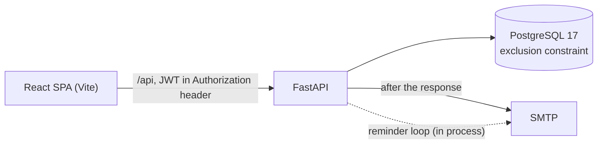

# Court Booking

[](https://github.com/EmilioPG13/reservation-system/actions/workflows/ci.yml)

Padel court reservations where **double bookings are impossible by construction**: PostgreSQL itself rejects overlapping reservations (an exclusion constraint on a time range), instead of the application checking first and hoping.

**Live demo:** _not deployed yet, see [DEPLOY.md](DEPLOY.md)_


Two browsers race for the same cell. One wins, the other is told so and sees the grid refresh:


## How double bookings are prevented

A "check availability, then insert" flow has a gap between the check and the insert, and two requests can both pass it. Here the application never checks: it inserts, and the database decides.

```sql
ALTER TABLE reservations ADD CONSTRAINT no_overlapping_confirmed
  EXCLUDE USING gist (resource_id WITH =, during WITH &&)
  WHERE (status = 'confirmed');
```

- `during` is a `tstzrange` stored as `[start, end)`, so back-to-back slots (10:00-11:00 and 11:00-12:00) do not overlap. A check constraint rejects any other bounds.
- The constraint is partial: cancelled reservations do not block their slot.
- The service catches the violation (SQLSTATE `23P01`) and the API answers `409 That slot was just taken`. A 409 means only that; every other refusal has its own status.
- [`test_reservations_concurrency.py`](backend/tests/test_reservations_concurrency.py) fires 20 simultaneous requests from 20 different users at one slot against a real PostgreSQL: exactly one gets 201, nineteen get 409.

## Architecture



- **Routers** hold no business rules and **services** know nothing about HTTP; the database enforces the invariants.
- The grid is one call: `GET /availability?date=` returns every court with all its slots (four queries, however many courts).
- The frontend client is generated from the API's OpenAPI document (`openapi-typescript`), so a changed endpoint breaks the build instead of production.

## Decisions

- **UTC in the database, local time in the interface.** Each court has its own time zone; slots are stepped in UTC, so a daylight-saving day simply has more or fewer real hours.
- **Half-open ranges `[)`** everywhere, for the reason above.
- **Polling, not real time.** The grid refreshes every few seconds with TanStack Query. It is simpler, survives free-tier hosting, and a lost race is already handled honestly. Server-sent events would be the next step.
- **No Redis, no queue.** Reminders are a loop inside the API process. A reminder is marked as sent *before* it is sent: if the process dies in between, one email is lost, instead of one being sent twice.
- **Short-lived access tokens only** (30 minutes, no refresh). A 401 sends the user back to login.
- **Admins are created from the command line**, never over HTTP.
- **An admin cancel also emails the user; a blackout does not cancel existing reservations.**
- **The reservation limit per user locks the user's row**, so one person cannot slip past it with simultaneous requests.

## Run it locally

Everything in containers (web on http://localhost:8080, change it with `WEB_PORT`):

```powershell
docker compose --profile app up --build
docker compose exec api python -m app.cli seed-demo     # 10 courts and sample reservations
```

Mail the app sends lands in Mailpit at http://localhost:8025.

For development, run the database and mail catcher in Docker and the rest natively:

```powershell
docker compose up -d --wait        # PostgreSQL 17 on :5433, Mailpit on :8025
cd backend
uv sync
cp .env.example .env               # set JWT_SECRET_KEY, there is no default on purpose
uv run alembic upgrade head
uv run uvicorn app.main:app --reload   # http://localhost:8000/docs
uv run python -m app.cli create-admin --email you@example.com --name You
cd ../frontend
npm install
npm run dev                        # http://localhost:5173, calls the API under /api
```

## Tests

```powershell
cd backend ; uv run pytest --cov=app    # needs the compose PostgreSQL
cd frontend ; npm test                  # Vitest + React Testing Library
cd frontend ; npm run test:e2e          # Playwright, needs the whole stack running
```

At the time of writing: 215 backend tests at 94% line coverage, 26 Vitest tests, and 3 Playwright tests against the real stack (the two-browser race, "my reservations", the admin cancel). CI runs ruff and pytest against a PostgreSQL service, plus lint, Vitest and the build for the frontend.

## Limitations

- The free-tier database suspends when idle, so the first visit can be slow. The interface shows a loading state instead of hiding it.
- The rate limiter is in memory, so it is correct for one API process only; several replicas would need a shared store.
- API error messages are in English and the interface translates the known ones; a new backend message shows a generic line until it is added to `frontend/src/lib/messages.ts`.
- No password reset and no email verification.
